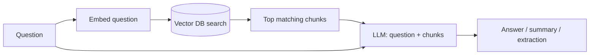

# Local LLM Test Run

> [!abstract] Goal
> Run a model on the current PC (==18 GB free==) to judge model size and speed **before** buying [[Beelink SER9 MAX]] (32 GB RAM, Linux).

## Model choice

| Model | Disk (Q4) | RAM while running | Notes |
|---|---|---|---|
| `qwen3.5:4b` | ~3.4 GB | ~4 GB | Fast, may be too weak |
| `qwen3.5:9b` | ~6.6 GB | ~7–9 GB | Good all-rounder |
| `qwen3:14b` ✅ | ~9 GB | ~10–12 GB | **Chosen for test**, smarter, ~½ speed of 8B |

> [!tip] Split-model idea
> Small model for instant commands (lights), 14B for background document digestion. Fits on 32 GB.

## Ollama basics

> [!info] What is Ollama?
> Free local runtime: downloads models, runs them on CPU/GPU, serves an API at `localhost:11434`. Nothing leaves the PC.

- **Downloaded** → stored on disk
- **Ollama** → always running in background (tray icon)
- **Model** → loads into RAM on request, ==unloads after ~5 min idle==
- **Deployed?** → yes, locally, via the API

### Commands

```powershell
ollama --version                  # check install
ollama run qwen3:14b --verbose    # chat + show speed
/set parameter num_gpu 0          # force CPU-only (mimics Beelink)
/set nothink                      # skip Qwen3 "thinking" for raw speed
/bye                              # exit
ollama ps                         # what's loaded in RAM now
ollama list                       # downloaded models
ollama rm <model>                 # free disk space
```

### Keep model always loaded

```powershell
setx OLLAMA_KEEP_ALIVE -1   # then restart Ollama
```
Or per API call: `"keep_alive": -1`

> [!warning] Cost
> Holds ~10 GB RAM permanently. Fine on 32 GB Beelink.

> [!note]- Desktop app vs PowerShell
> The Ollama app (Chat tab → model picker in message box) is fine for **quality** testing, but doesn't show tokens/sec or allow CPU-only. Use PowerShell for **speed** testing.

## Test checklist

- [x] Install Ollama
- [x] Download `qwen3:14b`
- [ ] Document test — paste a real bill/notice → JSON reminders (`title`, `due_date`, `notes`)
- [ ] Tool-call test — `set_light(room, state, brightness)` with "dim bedroom to 30, kitchen off"
- [ ] CPU-only speed test — record **eval rate** (tok/s)
- [ ] Record peak RAM (Task Manager → Performance → Memory)
- [ ] Decide: 14B good enough? Compare with 9B if borderline

> [!example] Results
> | Metric | Value |
> |---|---|
> | Eval rate (CPU-only) | |
> | Peak RAM | |
> | Document test | |
> | Tool-call test | |

Expected CPU-only: ~4–8 tok/s for 14B[^1]. Acceptable because long tasks run in the background.

## Architecture: personal data (RAG)

> [!important] The model stores nothing
> It's fixed. Your data lives **outside** it and is fed in per question.

**Where data lives**
1. **Originals** — PDFs, emails, notes in a folder (retrieve "as is")
2. **Chunks + embeddings** — vector DB (Chroma / pgvector)
3. **Structured facts** — dates, reminders in SQLite

**What happens on a question**



Pattern name: **RAG** (retrieval-augmented generation).

## Related
- [[Home AI Assistant]]
- [[Beelink SER9 MAX]]
- [[RAG]]

%% Next: fill results table, then decide model size and hardware. %%

[^1]: Roughly half the speed of an 8B/9B model on the same CPU.
