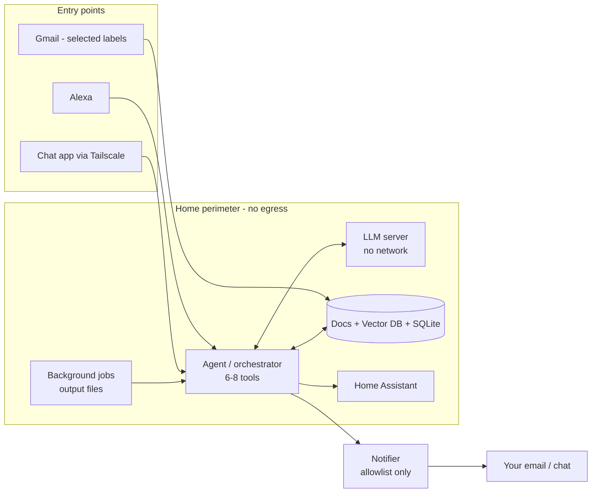

# 02 · Architecture

## Hosting options considered
| | A. Home box ✅ | B. Private AWS | C. Hybrid |
|---|---|---|---|
| Model runs | Mini PC at home | EC2, private subnet, no internet | Home box |
| Documents | Home | S3 with your own KMS key | Home |
| Cloud role | None | Everything | Entry points only (Alexa, email, chat) |
| Running cost | Electricity (10–40 W) | ~₹17,500/month | A few cents of Lambda |

> [!success] Decision
> **A. Home box.** It pays for itself against AWS in 4–5 months.

## Security perimeter
> [!info] The perimeter goes around the model, not inside it
> A model is just a file. Leaks come from the code and network around it.

- **LLM server:** no internet in either direction. One port, reachable only by the agent
- **Agent:** the only thing that talks to the model and to the outside world
- **Notifier:** the single way out, with a hardcoded allowlist (your email and chat ID). This makes prompt injection in documents harmless
- **Limit:** Alexa, email and chat pass through outside servers. For sensitive files, send a link reachable over Tailscale, not the attachment

## How the pieces connect

## Where data lives (RAG)
> [!important] The model stores nothing
> Your data stays outside the model and is fed in with each question. This is **RAG** (retrieval-augmented generation). Swap the model later and all the data carries over.

| What | Where |
|---|---|
| Model file | Disk, loaded into RAM when used |
| Original docs, emails, attachments | Folder on the 2nd SSD |
| Text chunks + embeddings | Vector DB (Chroma / pgvector) |
| Dates, reminders, tasks | SQLite |
| Precomputed answers | Output files from background jobs |

**On a question:** embed the question → search the vector DB → take the top chunks → send question + chunks to the LLM → answer.

## Model size ladder
| Size | Handles | Example |
|---|---|---|
| 1–3B | Single direct commands | "Dim the living room to 30%" |
| 4B | One tool with details | "Remind me to pay the electricity bill on the 5th" |
| 8B | Several steps or implied details | "Read this bill, add the due date, remind me two days earlier" |
| 14B / MoE | Long or subtle documents | "What changed between last year's and this year's lease?" |

- Candidates: Qwen3.5-4B, Gemma 4 E4B, Llama 3.1 8B, Qwen3 14B. All support tool calling
- The model only *outputs* a call such as `create_event(...)`. The agent validates it and makes the real call

## Agent design
- **One orchestrator** with 6–8 tools: lights, calendar, reminders, document search, document send, task list
- **Fast path:** simple light commands go straight to Home Assistant, with no LLM
- **Router step:** if tools grow past ~10, classify the request first (home / calendar / docs)

## Channels
| Channel | Choice |
|---|---|
| Chat | Home Assistant Companion, Signal or Matrix (Element), over Tailscale |
| Voice | Alexa, answering from precomputed output files |
| Email in | Gmail API or IMAP, read-only, selected labels only, one-time backfill, OCR for scans |
| Lyrics | Spotify (linked to Alexa) → Spotify Connect API for playback position; LRCLIB (free) or Musixmatch (paid) for synced lyrics |

> [!warning] Caveats
> - Background jobs share the GPU with live requests
> - Precomputed answers can go stale
> - Anything spoken to Alexa goes through Amazon

---
← [[01 - Requirements]] | [[Home AI Assistant]] | [[03 - Hardware]] →
