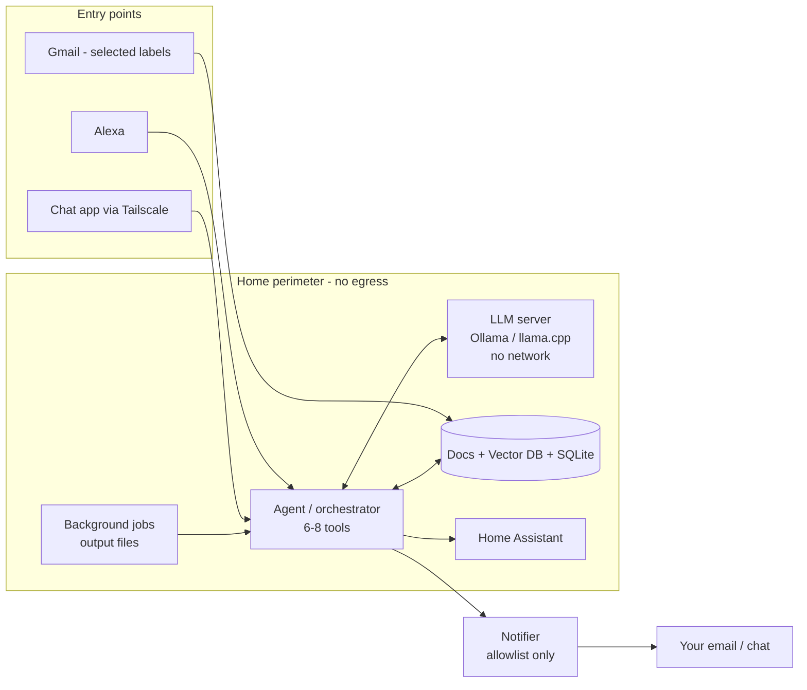

# Quick Revision

> [!abstract] One-liner
> Self-hosted small LLM on a home mini PC, inside a no-egress perimeter. Data lives outside the model (RAG). Alexa, chat and Gmail are the entry points. Heavy work runs in the background.

## 1. Hardware

### The pick
- **[[03 - Hardware|Beelink SER9 MAX]]**: Ryzen 7 H255 (8C/16T), Radeon 780M iGPU, 10GbE, 2× M.2, removable SO-DIMM RAM
- Earlier candidate: Beelink SER8 (8845HS), same chip class, 1G LAN
- Shortlist compared: GMKtec K12, Beelink SER8, Minisforum UM890 Pro, GEEKOM A8 Max, SER9 MAX
- OS: **Ubuntu Server, headless**. Ships with Win 11 Pro (install Linux over it, or put Linux on the 2nd SSD)

### RAM: 32 GB (decided)
> [!important] Size decides *what fits*. Bandwidth decides *how fast*.
> **tok/s ≈ memory bandwidth ÷ model size**
> All shortlisted boxes: DDR5-5600 dual channel = **89.6 GB/s**, e.g. 89.6 ÷ 5 GB (8B Q4) ≈ 18 tok/s

| On 32 GB | GB |
|---|---|
| 14B model (Q4) | ~9 |
| Context for long emails/PDFs | 2–4 |
| Ubuntu + Home Assistant + vector DB | 4–6 |
| **Spare** | **13–17** |

- 32 GB fits a **14B dense** or a **26–30B MoE** (~16–18 GB)
- 64 GB only buys: two models loaded at once, or longer documents. **No extra speed.**

### Must-have specs
- [ ] RAM as **2×16 GB** (single stick = single channel = half speed)
- [ ] **SO-DIMM**, not soldered (⚠️ SER9 **Pro** is soldered)
- [ ] Radeon 780M or better (avoid Intel N100/N150)
- [ ] 2× M.2: OS drive + data drive (portable data)
- [ ] Wired Ethernet with Linux-friendly NIC (Wi-Fi off)
- [ ] BIOS "Restore on AC power loss" + small UPS
- [ ] Spare USB 2.0 port for Zigbee/Thread dongle
- [ ] HDMI for the lyrics screen

### Gotchas
- No NPU despite "AI PC" marketing; AI runs on CPU/iGPU
- Linux gives the iGPU ~½ of RAM by default (~16 GB). 14B fits. MoE needs a one-line boot setting
- 10GbE (Realtek RTL8127) needs kernel 6.16+ or Realtek driver
- "Up to 256 GB" is theoretical; practical max ~128 GB
- Buying from amazon.com: check import duty and warranty (ship-back to Beelink)

### If more speed is needed later
- eGPU over **OCuLink** (GMKtec K12, Minisforum UM890 Pro have the port)
- Strix Halo (Ryzen AI Max+ 395) boxes: 256 GB/s, ~3× faster

### Test bench now
- Dell Precision 3571 laptop (i7-12800H, 32 GB, RTX A1000 4 GB). See [[04 - Local LLM Test Run]]
- Free RAM first (Chrome background apps are the main hog). Lower context window if 14B won't load

## 2. Hosting & Architecture

### How it works
> [!info] The model stores nothing
> It's a fixed file of weights. Your data sits **outside** it and is fed in per question (**RAG**). Swap the model later; data carries over.

### Where things live
| What | Where |
|---|---|
| Model file | Disk, loaded into RAM on use |
| Original docs, emails, attachments | Folder on 2nd SSD (sent back "as is") |
| Chunks + embeddings | Vector DB (Chroma / pgvector) |
| Dates, reminders, tasks | SQLite |
| Precomputed answers | Output files from background jobs |

### Security perimeter
- LLM server: **no internet either way**, one port only the agent reaches
- Agent: the only thing talking to the model *and* the outside
- **One way out**: notifier with a hardcoded allowlist (your email + chat ID). Defeats prompt injection in documents
- Limit: Alexa, email and chat travel through outside servers. Send links over Tailscale for sensitive files, not attachments

### Model & runtime
- Size: **4B–8B** for daily tasks (Qwen3.5-4B, Gemma 4 E4B, Llama 3.1 8B). **14B** under test. 26–30B MoE is the ceiling
- All support tool calling: model outputs `create_event(...)`, agent validates and executes
- **One orchestrator**, 6–8 tools. Lights go straight to Home Assistant (no LLM). Add a router step if tools grow
- Runner: Ollama / LM Studio for testing, **llama.cpp (Vulkan)** on the mini PC

### Design choices
- Long tasks run in the background; Alexa answers from precomputed output files
  - Caveats: shared GPU contention, stale answers
- Chat: Telegram (no E2E) and WhatsApp (overhead) ruled out. Options: **Home Assistant Companion, Signal, Matrix/Element**
- Lyrics: Spotify (linked to Alexa) → Spotify Connect API for position; synced lyrics from **LRCLIB** (free) or Musixmatch (paid)
- Gmail: IMAP or Gmail API read-only; ingest selected labels only; one-time backfill; OCR for scans
- Cloud (AWS) rejected: ~₹17,500/month vs home box paying back in 4–5 months

## 3. Open items
- [ ] Finish [[04 - Local LLM Test Run]]: tok/s, peak RAM, doc + tool-call tests
- [ ] Decide model size (8B vs 14B)
- [ ] Confirm mini PC purchase and source (India vs US)

## Related
- [[Home AI Assistant]] · [[03 - Hardware|Beelink SER9 MAX]] · [[04 - Local LLM Test Run]] · [[02 - Architecture|RAG]]

---
← [[04 - Local LLM Test Run]] | [[Home AI Assistant]]
